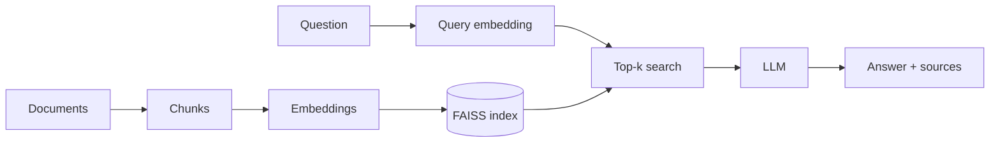

# DocsRAG

DocsRAG is a small retrieval-augmented generation (RAG) REST API that answers questions about a
folder of documents. It ingests `.txt`, `.md` and `.pdf` files, splits them into overlapping
chunks, embeds them locally with `all-MiniLM-L6-v2`, stores the vectors in FAISS, and for each
question retrieves the top-k chunks and asks an Anthropic Claude model to answer **only** from that
context, citing the source file names.



## Features
- Local embeddings (no API key needed for ingestion/retrieval), FAISS inner-product search
- Grounded answers with source citations; "I don't know" when the context lacks the answer
- FastAPI with OpenAPI docs at `/docs`, request logging, CORS
- Clear error codes: 422 invalid input, 503 index not built, 502 LLM failure
- Retrieval evaluation script, pytest suite (LLM mocked), Docker image, GitHub Actions CI

## Quick start

Local:
```bash
python3.11 -m venv .venv && source .venv/bin/activate
pip install -r requirements.txt
cp .env.example .env            # then set ANTHROPIC_API_KEY
python -m app.ingest            # builds storage/index.faiss + storage/meta.json
uvicorn app.main:app --reload   # http://localhost:8000/docs
```

Docker (the index is baked into the image at build time):
```bash
docker build -t docsrag . && docker run -p 8000:8000 -e ANTHROPIC_API_KEY=$ANTHROPIC_API_KEY docsrag
```

## API reference

```bash
curl localhost:8000/health
# {"status":"ok","index_loaded":true}

curl -X POST localhost:8000/ask -H 'Content-Type: application/json' \
  -d '{"question": "Who invented the printing press?", "top_k": 3}'

curl -X POST localhost:8000/ingest
# {"documents":6,"chunks":6}
```

Sample `/ask` response:
```json
{
  "answer": "Johannes Gutenberg invented the movable-type printing press around 1440 [printing_press.txt].",
  "sources": [
    {"source": "printing_press.txt", "chunk_index": 0, "score": 0.71},
    {"source": "roman_empire.md", "chunk_index": 0, "score": 0.12}
  ]
}
```
`question` is 1-1000 characters; `top_k` is optional (1-10, default `TOP_K`). Errors return
`{"detail": "..."}`. `index_loaded` in `/health` means the index files exist on disk.

## Configuration

| Variable | Default | Meaning |
|---|---|---|
| `DOCS_DIR` | `data/docs` | Documents folder |
| `INDEX_DIR` | `storage` | Where the index and metadata are written |
| `EMBED_MODEL` | `all-MiniLM-L6-v2` | sentence-transformers model |
| `CHUNK_SIZE` | `500` | Words per chunk |
| `CHUNK_OVERLAP` | `50` | Words shared by adjacent chunks |
| `TOP_K` | `4` | Chunks retrieved per question |
| `LLM_MODEL` | `claude-sonnet-5-5` | Anthropic model name |
| `MAX_TOKENS` | `600` | Max answer tokens |
| `ANTHROPIC_API_KEY` | none | API key (never logged) |

## Tests and evaluation
```bash
pytest -q                  # no API key needed; the LLM is mocked (embedding model must be cached)
ruff check . && ruff format --check .
python -m app.ingest && python eval/run_eval.py   # exits 1 if top-k hit rate < 70%
```
The evaluation runs retrieval only. Note the sample corpus is tiny (one chunk per file), so
the hit rate with `TOP_K=4` is optimistic; use a larger corpus for meaningful numbers.

## Design decisions
- **Chunk size 500 words / 50 overlap:** large enough to keep a passage's context, small enough
  to fit several chunks in the prompt; the overlap avoids cutting facts at chunk boundaries.
- **Normalized embeddings + inner product:** on unit vectors, inner product equals cosine
  similarity, and `IndexFlatIP` gives exact search with no extra normalization at query time.
- **Local embeddings:** free, private, reproducible, and no API key for ingestion or tests.
- **Assumptions:** CORS allows all origins (demo only); the index is rebuilt wholesale by
  `/ingest`; PDFs are read as text only (no OCR); the retriever is created lazily and reloaded
  after `/ingest`.

## Limitations and next steps
Re-ranking with a cross-encoder, hybrid BM25 + vector search, streaming responses,
authentication and rate limiting, incremental indexing, deployment on AWS ECS/EC2.

## Security
The API key is supplied only via the `ANTHROPIC_API_KEY` environment variable; no secrets are in
the repo and `.env` is git-ignored. `/ingest` is unauthenticated, so add auth before exposing it.
