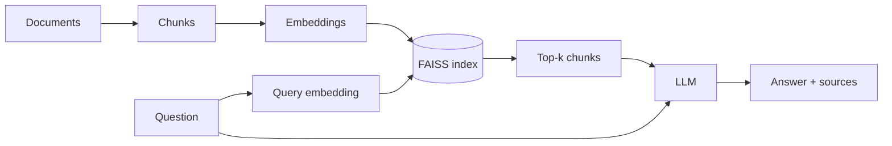

# DocsRAG

DocsRAG is a small, production-style Retrieval-Augmented Generation (RAG) REST API. It ingests a
folder of documents (`.txt`, `.md`, `.pdf`), splits them into overlapping chunks, embeds them
locally with `all-MiniLM-L6-v2`, stores the vectors in FAISS, and answers questions by retrieving
the top-k chunks and asking an LLM to answer **only** from that context, citing its sources.
The LLM is provider-agnostic: any OpenAI-compatible API works (Gemini, OpenAI, Grok, Claude, Groq, Ollama, ...).

The bundled sample corpus is 7 Wikipedia articles taken from the
[SQuAD](https://huggingface.co/datasets/rajpurkar/squad) dataset on Hugging Face (CC BY-SA 4.0).

## Architecture



## Features

- Local embeddings (no key needed for retrieval), FAISS inner-product search
- Works with any OpenAI-compatible LLM provider from just an API key (endpoint and model are auto-detected)
- Citations: every answer returns the chunks it was based on, with scores
- FastAPI with a built-in chat UI at `/`, OpenAPI docs at `/docs`, request logging, CORS
- Injectable LLM client, so tests run with no API key and no network
- Retrieval evaluation script (hit rate@k), Dockerfile with a baked index, GitHub Actions CI

## Quick start

Local:

```bash
python -m venv .venv
source .venv/bin/activate        # Windows: .venv\Scripts\activate
pip install -r requirements.txt
cp .env.example .env             # then set LLM_API_KEY
python -m app.ingest             # build the index
uvicorn app.main:app --reload
```

Docker:

```bash
docker build -t docsrag . && docker run -p 8000:8000 -e LLM_API_KEY=$LLM_API_KEY docsrag
```

Open http://localhost:8000 for the chat UI (or http://localhost:8000/docs for the Swagger API docs).

## API reference

```bash
curl localhost:8000/health
# {"status":"ok","index_loaded":false}

curl -X POST localhost:8000/ask -H "Content-Type: application/json" \
  -d '{"question": "When was the Royal University of Warsaw established?", "top_k": 3}'

curl -X POST localhost:8000/ingest
# {"documents":7,"chunks":96}
```

Sample `/ask` response:

```json
{
  "answer": "The Royal University of Warsaw was established in 1816 [warsaw.md].",
  "sources": [
    {"source": "warsaw.md", "chunk_index": 7, "score": 0.71},
    {"source": "warsaw.md", "chunk_index": 8, "score": 0.52}
  ]
}
```

Errors return `{"detail": "..."}`: `422` invalid input, `503` index not built, `502` LLM call failed.

## Configuration

| Variable | Default | Description |
|---|---|---|
| `LLM_API_KEY` | none | API key of your LLM provider (never logged) |
| `LLM_BASE_URL` | auto-detected | Provider endpoint; inferred from the key prefix, set it only for unknown providers or local servers |
| `LLM_MODEL` | auto-detected | Model name; if empty, the app lists the models your key can use and picks a fast chat model |
| `MAX_TOKENS` | `600` | Max tokens in the answer |
| `TOP_K` | `4` | Chunks retrieved per question |
| `DOCS_DIR` | `data/docs` | Documents folder |
| `INDEX_DIR` | `storage` | Where the index is saved |
| `EMBED_MODEL` | `all-MiniLM-L6-v2` | sentence-transformers model |
| `CHUNK_SIZE` | `500` | Words per chunk |
| `CHUNK_OVERLAP` | `50` | Words shared between chunks |

Just set `LLM_API_KEY`. The provider endpoint is inferred from the key prefix and the model is
picked from the list your key can access (`GET /models`), preferring fast "flash"/"mini"-style chat models.

| Key prefix | Provider |
|---|---|
| `AIza` | Google Gemini |
| `sk-ant-` | Anthropic Claude |
| `xai-` | Grok (xAI) |
| `gsk_` | Groq |
| `sk-or-` | OpenRouter |
| `sk-` | OpenAI |

For anything else (e.g. a local Ollama at `http://localhost:11434/v1`) set `LLM_BASE_URL`.
Set `LLM_MODEL` to override the automatic model choice.
## Tests and evaluation

```bash
pytest -q                  # no API key or network needed (after the model is cached)
python eval/run_eval.py    # retrieval hit rate@k, exit code 1 if below 70%
ruff check . && ruff format --check .
```

`python scripts/fetch_dataset.py` re-downloads the sample documents and `eval/questions.json`
from Hugging Face.

## Design decisions

- **Chunk size 500 words / overlap 50**: large enough to keep a paragraph's context, small enough
  for precise retrieval and for several chunks to fit in the prompt; overlap avoids cutting an answer in half.
- **Normalized embeddings + inner product**: on unit vectors inner product equals cosine similarity,
  and `IndexFlatIP` is exact and simple.
- **Local embeddings**: no cost, no key, no data leaving the machine for retrieval, and tests stay offline.
- **OpenAI-compatible LLM interface**: one client covers most providers without per-vendor code.
- **Unspecified choices**: `/ingest` returns 400 if there is nothing to index; CORS allows all origins
  (demo only, restrict it in production).

## Limitations and next steps

Re-ranking with a cross-encoder, hybrid BM25 + vector search, streaming responses, authentication and
rate limiting, incremental indexing, and deployment on AWS ECS/EC2. The flat index is exact but
does not scale to millions of chunks.

## Security

The API key is read from an environment variable only and is never logged. No secrets are in the
repo; `.env` is git-ignored. CORS is open for the demo.
